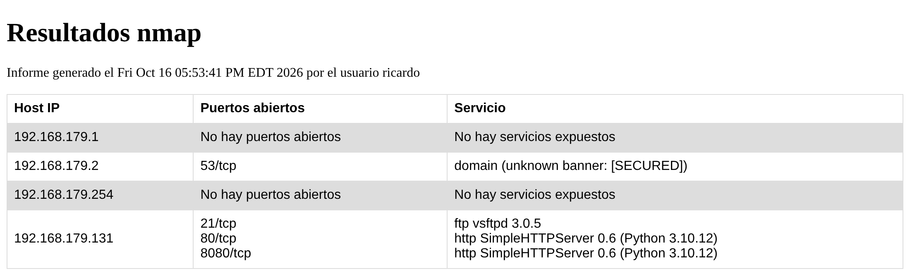
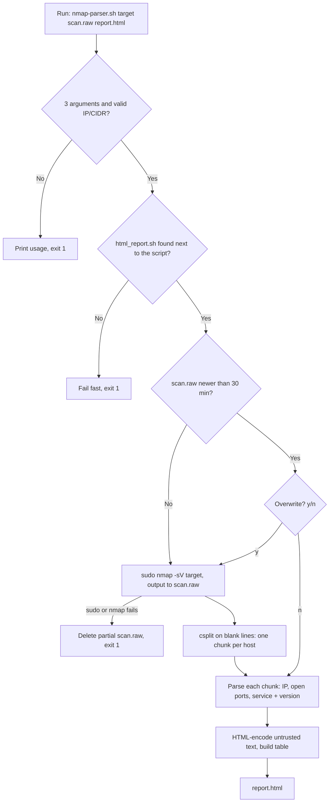

# 🛰️ Nmap Parser: From Raw Scans to Secure HTML Reports


A Bash tool that runs an Nmap service-detection scan against a network, splits the raw output per host, and turns it into a clean HTML report of live hosts, open ports and service versions. It is hardened against argument injection and Cross-Site Scripting (XSS), and it passes ShellCheck with zero warnings.

---

## 📌 Executive summary

Nmap's human-readable output is hard to review quickly. On a `/24` network, the information that matters (which hosts are up, what they expose, and which software versions they run) is scattered across hundreds of lines. This project automates that step and produces an **asset and attack-surface inventory** that you can open in any browser.

The tool was built iteratively and then tested adversarially. That testing uncovered real defects, including **open ports that silently disappeared from the report** (false negatives), **service banners that could inject JavaScript into the report**, and **command-line arguments that could reach `sudo nmap` as options**. Each finding, its root cause and its fix are documented below.

> Script messages and report labels are in Spanish.

---

## 📸 Example report



*Report generated from a scan of my virtualized home lab (private range `192.168.179.0/24`). Note how ports `80` and `8080` both appear on the same host. That case used to break the parser (see [Finding #2](#2-open-ports-silently-missing-false-negatives)).*

---

## 🏗️ Overview


## 🏗️ How it works



### Components

| File | Role |
|---|---|
| `nmap-parser.sh` | Entry point. Validates the input, runs or reuses the scan, splits it per host and writes the report. |
| `html_report.sh` | Parsing and presentation. Extracts IP, ports and services from each host chunk, HTML-encodes untrusted data and renders the table. It is loaded with `source`, so it shares variables with the main script. |

Keeping **logic** (scan and control flow) separate from **presentation** (HTML) means a different output format, such as CSV or Markdown, only needs a new renderer file.

### Parsing strategy

1. **One chunk per host.** `csplit` cuts the raw output on blank lines (`xx00`, `xx01`, …), so each `grep` only ever sees a single host and ports from different hosts cannot get mixed up.
2. **Host IP** is extracted with `([0-9]{1,3}\.){3}[0-9]{1,3}`, which also works for lines like `Nmap scan report for ubuntu-vm (192.168.179.131)`.
3. **Open ports** are matched with `^[0-9]{1,5}/(tcp|udp) +open`. The ` +` matters (see Finding #2).
4. **Service and version** are taken by **field** with `awk` (everything after the port and state), not with a regex.

---

## 🚀 Usage

### Requirements

- Linux with Bash (tested on Ubuntu in a virtual machine)
- `nmap` and `sudo` privileges (service detection needs raw packets)
- GNU coreutils (`csplit`), `grep`, `awk`, `sed`

### Installation

```bash
git clone https://github.com/Ricardopirlo/nmap-parser.git
cd nmap-parser
chmod +x nmap-parser.sh
```

### Syntax

```bash
./nmap-parser.sh <ip[/mask]> <output.raw> <report.html>
```

| # | Argument | Description | Example |
|---|---|---|---|
| 1 | Target | Single host or network in CIDR notation. Only digits, dots and one `/` are accepted. | `192.168.179.0/24` |
| 2 | Raw output | File where the raw Nmap output is saved (or reused). | `salida_nmap.raw` |
| 3 | Report | HTML report to generate. | `resultados.html` |

### Example run

```text
$ ./nmap-parser.sh 192.168.179.131/24 salida_nmap.raw resultados.html
[INFO] Ejecutando nmap en la subred 192.168.179.131/24, por favor espere unos segundos...
[OK] Fichero salida_nmap.raw generado correctamente
[INFO] Dividiendo el fichero salida_nmap.raw ...
[OK] Fichero salida_nmap.raw dividido en: xx00 xx01 xx02 xx03 xx04
[INFO] Generando reporte html...
[OK] Reporte resultados.html generado correctamente
```

### Reusing a recent scan

If the raw file is less than 30 minutes old, the script asks before scanning again:

```text
existe salida_nmap.raw con antiguedad menor a 30 minutos. sobreescribir? [y/n]:
```

Answering `n` regenerates the report from the existing scan. That is useful when you only change the report format, and it avoids repeating a noisy scan that an IDS would flag. Invalid answers are rejected and the question is asked again.

### Exit codes

| Code | Meaning |
|---|---|
| `0` | Report generated successfully |
| `1` | Any error: invalid arguments, missing `html_report.sh`, `sudo`/Nmap failure or unwritable report path |

Errors go to `stderr`, so the script composes well with other commands:

```bash
./nmap-parser.sh 192.168.179.0/24 salida_nmap.raw resultados.html && xdg-open resultados.html
```

---

## 🐛 Real findings during development

These defects were found by testing the tool with varied and hostile input, not just the happy path. Several of them **produced wrong results without any error message**.

### 1. Empty report (0 bytes) with a success message

- **Symptom:** `resultados_nmap.html` was created with 0 bytes, yet the script printed `[OK]`.
- **Root cause:** a regex inside the heredoc's command substitution had **unbalanced single quotes**, so Bash failed while expanding the template. Bash also **opens (and truncates) the redirect target before running the command**, which is why an empty file was left behind. The `[OK]` was printed unconditionally.
- **Fix:** corrected the regex to `([0-9]{1,3}\.){3}[0-9]{1,3}` and made every `[OK]` depend on the command's exit code.

### 2. Open ports silently missing (false negatives)

- **Symptom:** on a host exposing ports `22`, `80` and `3306`, the report only listed `3306`.
- **Root cause:** Nmap pads the PORT column to the **widest port of each host**, so `22/tcp   open` has three spaces. The original regex `(tcp|udp) open` required **exactly one**.
- **Fix:** `(tcp|udp) +open` (one or more spaces). In a security report, a false negative is the worst kind of bug, because it says a service is not exposed when it is.

### 3. Service versions truncated

- **Symptom:** `53/tcp open domain dnsmasq 2.89` was shown as `open domain dnsmasq`, losing the version, which is the data you would look up for CVEs. `microsoft-ds?` was shown as just `open`.
- **Root cause:** the greedy regex `' .* '` matched from the first space to the **last** space of the line.
- **Fix:** field-based extraction with `awk '{$1=$2=""; sub(/^ +/, ""); print}'`.

### 4. "Ghost hosts" from previous scans

- **Symptom:** hosts that were no longer on the network still appeared in new reports.
- **Root cause:** the scan-and-split logic was **duplicated** in two branches. In one of the copies, `rm -f xx*` had ended up on the same line as an `echo`, so it was printed instead of executed, and stale chunks from older scans survived.
- **Fix:** a single `escanear_y_dividir` function shared by both branches.

### 5. Empty report when launched from another directory

- **Symptom:** running `../project/nmap-parser.sh` produced a 0-byte report and `generar_html: command not found`.
- **Root cause:** `source html_report.sh` resolved the path from the **current directory**, not from the script's location.
- **Fix:** `source "$(dirname "$0")/html_report.sh"`, with the check moved to the beginning of the script so it fails before a multi-minute scan rather than after it.

### 6. Scan cache ignored for file names with spaces

- **Symptom:** with `"my scan.raw"`, the script re-scanned every time and never offered to reuse the recent file.
- **Root cause:** the unquoted `find $2` split the name into two non-existent paths (`my` and `scan.raw`).
- **Fix:** quote every expansion: `[ -n "$(find "$2" -mmin -30 2>/dev/null)" ]`.

---

## 🔐 Security hardening

| Threat | Mitigation | Concept |
|---|---|---|
| **Argument injection:** a target such as `--script=/tmp/evil.nse` reached `sudo nmap` intact. NSE scripts are Lua code, so this means code execution as root. Nmap is listed on [GTFOBins](https://gtfobins.github.io/gtfobins/nmap/) for this reason. | Strict, anchored allowlist for the target argument | Input validation |
| **Stored XSS via service banners:** part of the version column is text sent by the scanned service itself. A DNS server answers `version.bind` with whatever its administrator configured (my lab returns `[SECURED]`), so a hostile host could return `<script>…</script>`. | HTML-encode `&`, `<` and `>` before inserting data into the report | Output encoding |
| **Over-privileged operations** | Only `nmap` runs through `sudo`. The output redirect is done by the invoking user, so scan files are never owned by root. ShellCheck's SC2024 is suppressed with a documented reason. | Least privilege |
| **Silent failures** | Exit-code checks, early `exit 1`, errors on `stderr`, partial scan files deleted | Fail fast, reliable automation |
| **Word splitting** | Every variable and command substitution is quoted | Defensive scripting |

### Input allowlist

```bash
patron_red='^([0-9]{1,3}\.){3}[0-9]{1,3}(/[0-9]{1,2})?$'
if [[ ! $1 =~ $patron_red ]]; then
    echo "[ERROR] '$1' no es una IP o red válida (ej.: 192.168.179.0/24)" >&2
    uso
fi
```

- The anchors `^` and `$` are essential. Without them, `192.168.179.0/24 --script=x` is accepted, because Bash finds a valid IP **inside** the string.
- **Quoting alone would not have been enough:** `"--script=x"` is still a single, perfectly valid Nmap option. Only an allowlist stops it.

### Output encoding

```bash
lineas=$(grep -E '^[0-9]{1,5}/(tcp|udp) +open' "$i" | sed 's/&/\&amp;/g; s/</\&lt;/g; s/>/\&gt;/g')
```

- `&` is encoded **first**. Otherwise `&lt;` would become `&amp;lt;` (double escaping).
- In `sed`, a bare `&` in the replacement means "the matched text", so it must be written as `\&`.
- Encoding happens **before** the script adds its own `<br>` tags. Untrusted data gets encoded; the tool's own markup does not.
- Tested in Chromium with a banner containing `<script>alert(…)</script>`. Before the fix, the alert fired and the cell looked **empty** to the reader. After the fix, the payload is displayed as plain text.

---

## ✅ Validation

### Static analysis

```bash
shellcheck nmap-parser.sh html_report.sh   # 0 warnings
```

### Test matrix

| Scenario | Expected behavior | Result |
|---|---|---|
| No arguments / wrong number of arguments | Usage message, exit `1` | ✅ |
| Target `--script=/tmp/evil.nse` | Rejected before Nmap runs | ✅ |
| Target `192.168.179.0/24 --script=x` | Rejected (anchored regex) | ✅ |
| `html_report.sh` missing | Fails in under a second, before scanning, exit `1` | ✅ |
| Wrong `sudo` password (3 attempts) | `[ERROR]`, partial `.raw` deleted, exit `1` | ✅ |
| Report path not writable (`/root/…`, missing folder) | `[ERROR]`, exit `1` | ✅ |
| Run from another directory | Report generated correctly | ✅ |
| Host with ports `80` and `8080` | Both listed and aligned with their services | ✅ |
| Malicious banner `<script>` | Rendered as text, nothing executed | ✅ |
| Raw file name with spaces | Recent scan detected, reuse offered | ✅ |
| Answers `Y` / `N` / invalid | Accepted / accepted / asked again | ✅ |

The `sudo` test also showed the audit trail it leaves: every failed attempt is logged in `/var/log/auth.log` with the user, terminal, working directory and **exact command** (`/usr/bin/nmap -sV 192.168.179.131/24`). That is exactly what a SOC analyst would see in a SIEM.

---

## 🗂️ Repository structure

```text
nmap-parser/
├── nmap-parser.sh        # Entry point: validation, scan, split, report
├── html_report.sh        # Parser + HTML renderer (loaded with source)
├── docs/
│   └── report-example.png
├── .gitignore            # Keeps scan results and temp chunks out of Git
├── LICENSE
└── README.md
```

> **Note on `.gitignore`:** scan outputs (`*.raw`, `xx*`, `*.html`) are never committed. They describe a real network (hosts, services and versions), and that is exactly the kind of reconnaissance data that should not end up on a public repository.

---

## ⚠️ Known limitations

- **Temporary chunks are shared between scans.** The `xx*` files are created in the current directory and are not tied to a specific `.raw` file. If you work with several `.raw` files in the same directory and answer `n` (reuse), the report may show the hosts of the **last scan performed** instead of those in the requested file, without any warning.
  - *Workaround:* use one directory per scanned network, or answer `y` when switching to a different `.raw` file.
- **`xx*` files in the current directory are deleted.** Before splitting a new scan, the script runs `rm -f xx*` in the directory it is launched from. Any personal file whose name starts with `xx` would be removed.
  - *Workaround:* run the script from a dedicated directory.

## 🛣️ Roadmap

- [ ] Work in a private temporary directory (`mktemp -d`) and clean it up automatically with `trap`, without touching the user's directory.
- [ ] Split the `.raw` file on every run, including when reusing a scan, so the report always matches the requested file.
- [ ] Parse Nmap's XML output (`-oX`) instead of the human-readable format, which is more robust against layout changes.
- [ ] Highlight cleartext services (FTP, Telnet, HTTP) to help prioritize findings.

---

## 🧠 Key technical takeaways

- **Parsing human-readable output is fragile.** A change in column padding silently dropped open ports. In security tooling, false negatives are more dangerous than crashes, because nothing looks wrong.
- **Scan results are untrusted input.** Service banners are controlled by whoever runs the service, so they must be encoded before being rendered.
- **Allowlists beat blocklists, and quoting is not validation.** `"--script=x"` is a single, well-quoted argument and still a dangerous one.
- **Least privilege applies inside scripts too.** Only the command that truly needs root should run with `sudo`.
- **Honest exit codes make automation trustworthy.** An `[OK]` that is printed unconditionally is worse than no message at all.
- **Duplicated code hides bugs.** The "ghost hosts" defect lived in only one of two identical copies of the same logic.

---

## 📄 License & legal disclaimer

### License

Released under the [MIT License](LICENSE).

### Legal & ethical use

This tool is intended for **educational purposes and authorized testing only**. Only scan networks and systems that you own or have **explicit written permission** to test. Unauthorized port scanning may be illegal in your jurisdiction and may violate the terms of service of your network provider or employer. The author is not responsible for any misuse.

---

Built by **Ricardo** ([@Ricardopirlo](https://github.com/Ricardopirlo)) as part of my hands-on cybersecurity learning.
